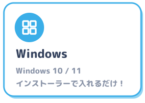
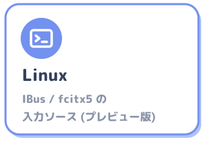

<p align="center">
  
</p>

<a name="meltype-for-mac"></a>
<p align="center"></p>

<p align="center"><b>雪解けのように、半角/全角の壁を溶かす日本語入力。</b></p>

<p align="center">
  <a href="https://github.com/yksr-melt/Meltype/releases/latest"></a>
  
  
</p>

<p align="center">
  <a href="https://github.com/yksr-melt/Meltype/releases/latest"><b>ダウンロード</b></a>
  &nbsp;·&nbsp;
  <a href="../README.md">トップの README</a>
  &nbsp;·&nbsp;
  <a href="https://github.com/yksr-melt/Meltype/issues/new/choose">不具合の報告・提案</a>
</p>

<p align="center">
  <a href="../docs/WINDOWS.md"></a>
  <a href="README.md"></a>
  <a href="../linux/README.md"></a>
</p>

Mac の正式な IME の仕組み (Input Method Kit) で動く Meltype です。Windows 版と同じく、日本語を打っている途中の英単語は英字のまま、
英語とも日本語とも読める語は前後の文脈で判定します。Mac では OS が IME としてキーを渡してくれるので、
メニューバーの入力メニューにもふつうの IME として表示されます。

> **プレビュー版です。** 動かないところやビルドエラーがあれば、エラーの全文とあわせて [Issues](https://github.com/yksr-melt/Meltype/issues) で教えてください！

<br>

<a name="動く環境"></a>
<br>

- macOS 13 以降
- 配布している zip は Apple シリコン (M1 / M2 / M3 / M4 …) の Mac 用です。Intel の Mac では、[ソースからビルド](#ソースからビルドする)してください (ビルドした CPU 向けのアプリができるので、Apple シリコン版と Intel 版は互換ではありません)

<br>

<a name="インストール"></a>
<br>

Meltype はアプリではなく「入力ソース」(日本語入力) です。`Meltype.app` をダブルクリックしても何も起きません。

1. [Releases](https://github.com/yksr-melt/Meltype/releases/latest) から `Meltype-<version>-mac.zip` をダウンロードして、**zip 全体を**展開する (インストーラーが `install-app.sh`・`start-input-method.sh`・`select-input-source.swift` も使います)
2. 「Install Meltype.command」をダブルクリック
   - 「開発元が未確認のため開けません」と出たら、右クリック (control + クリック) →「開く」→「開く」
   - macOS 15 以降は、一度ダブルクリックしてから、システム設定 → プライバシーとセキュリティ → 下のほうの「このまま開く」を押す
   - それでも開けないときは、「ターミナル」で `bash ~/Downloads/Meltype-mac/install.sh` を実行する
3. インストーラーが Meltype を登録・起動し、入力ソースを選びます。通常の更新では、システム設定を開く必要はありません

起動エラーが出たときは、入力メニューから ABC または標準の日本語入力を選んでください。初回に入力ソースが見つからないときだけ、ログアウト・ログインしてから入力メニューを確かめてください。

<a name="ソースからビルドする"></a>


必要なもの:

- Xcode 16.3 以降、またはそのコマンドライン ツール (`xcode-select --install`)。Swift 6.1 以降が必要です
- .NET 10 SDK (<https://dotnet.microsoft.com/download>。または `curl -sSL https://dot.net/v1/dotnet-install.sh | bash -s -- --channel 10.0`)

```bash
cd mac
./build.sh
```

1. 本体 (C#) を NativeAOT でビルドし、IME (Swift) をビルドして、`build/Meltype.app` を作ります (初回は azooKey の変換エンジンと辞書、ニューラル変換のモデル (約 74MB) のダウンロードで時間がかかります)
2. `~/Library/Input Methods/Meltype.app` にインストールします
3. メニューバーの入力メニューで Meltype を選ぶと使えます。出てこなければ、**システム設定 → キーボード → 入力ソース →「編集…」→「+」→ 日本語 → Meltype** を追加し、それでも出てこなければ、いったんログアウトしてログインし直します

作り直したときは `./build.sh` をもう一度実行すれば入れ替わります (動いている Meltype は自動で止めます)。
`mac/.build` (Swift のビルド結果) は azooKey の辞書の置き場所として使われることがあるので、消さないでください。

<br>

<a name="使い方"></a>
<br>

ふつうにローマ字で打つと、下線付きの変換中の文字になります。英単語 (google, github …) は英字のまま！

| キー | |
|---|---|
| <kbd>Space</kbd> | 変換 (候補の一覧が出ます) |
| <kbd>Enter</kbd> | 確定 |
| <kbd>←</kbd> <kbd>→</kbd> | 文節を選ぶ |
| <kbd>Esc</kbd> | 取り消し |
| <kbd>F6</kbd> / <kbd>F7</kbd> / <kbd>F8</kbd> | ひらがな / カタカナ / 半角カタカナ |
| <kbd>F9</kbd> / <kbd>F10</kbd> | 全角英数 / 半角英数 |
| <kbd>英数</kbd> / <kbd>かな</kbd> | JIS キーボードで、英数 (直接入力) / 日本語に戻る |

- 変換中に Shift+↓ / PageDown で候補を次のページ (9 個ずつ)、Shift+↑ / PageUp で前のページへ (Shift+↑↓ のページ送りは Mac だけです)。1 ページに収まるときは動きません。1〜9 でそのページの候補を選べます
- `zh` `zj` `zk` `zl` で ← ↓ ↑ → (macOS 標準の日本語入力と同じ。`z/` → ・ などの z + 記号も使えます)
- 確定済みの文字 (漢字・かな、128 文字まで) を選択して Control+Shift+R で再変換 (Enter で確定、Esc で元の文字に戻る。英数字・記号を含む選択、書式付きの文字 (リンク・太字の一部など)、ターミナルなど選択範囲を置き換えられないアプリでは再変換せず、キーはアプリにそのまま渡ります。再変換の直後は元の文字が選ばれた状態で、そのまま Enter なら何も変わりません)
- 「英数」「かな」キーが無い US 配列などでは、Control+Shift+J で日本語、Control+Shift+; (または ') で英数に切り替えられます (変換中の文字は確定してから英数になります。入力中は、Ctrl キーの割り当てがあればそちらが先に使われます。Apple の案内では、英字への切り替えは JIS 配列が Control+Shift+;、US 配列が Control+Shift+' ですが、Meltype は物理キーで判定するので、どちらの配列でも ; と ' の両方で英数になります。Apple の US 配列で Control+Shift+; は半角カタカナのモードですが、Meltype にはそのモードが無いので英数にしています。Control+Shift+K (カタカナ)・L (全角英字) など Meltype に無いモードのキーは何もせずアプリへ通します)
- 先頭か空白の直後に打った `/review`・`$skill`・`@ファイル名` は、空白まで変換せずにそのまま入ります (`SigilWordsDirect` で OFF)
- 設定・学習データ・ユーザー辞書は `~/Library/Application Support/Meltype` (入力メニューの「Meltype のデータフォルダを開く」)。設定は Windows 版と同じ `config.json` です (自動判定の強さ `DetectionLevel` など)
- 記号の幅を記号ごとに決めるには、`config.json` の `"FullWidthSymbols"` (いつも全角にする記号) と `"HalfWidthSymbols"` (いつも半角にする記号) に、記号を並べて書きます。たとえば `"FullWidthSymbols": "()"` で括弧が Mac の日本語入力と同じ全角の（ ）に、`"HalfWidthSymbols": "<>`"` で `<` `>` `` ` `` が日本語の中でも半角になります (書いていない記号は今までどおり。`-` `,` `.` `/` は対象外。URL・パスの中の括弧は書いてあっても半角のまま)。書き換えると、開いたままの入力欄にも 1 秒ほどで効きます。
- `"LongVowelOnlyAfterKana": true` で、`-` を長音の「ー」にするのはかなのすぐ後ろ (らーめん) だけになり、打ち始めや記号・英字の後ろでは半角の `-` のままです (`- 箇条書き`、`->`)。`"SpaceCommitsSymbols": true` で、幅を決めた記号 (と半角にした `-`) だけを打って Space を押すと、候補を開かずに確定して空白を入れます (`# 見出し`、`- 箇条書き`、`> 引用`)。どちらも書かなければ今までどおりです。
- ¥ キー・`\` キーで半角の `\` (バックスラッシュ) を入れるには、`config.json` に `"YenKey": "Backslash"` と書きます (書かない・`"Yen"` なら今までどおりで、JIS 配列の ¥ キーは `¥`、日本語の中で打った `\` は全角の ￥)。英数のときにも効き、Option+¥ は変えません。
- キーを文字にするのに使う英字のキーボード配列 (macOS の日本語入力の「英字のレイアウト」) を決めるには、`config.json` の `"LatinKeyboardLayout"` に入力ソースの ID を書きます (`"com.apple.keylayout.ABC"`、`"com.apple.keylayout.US"`、`"com.apple.keylayout.Dvorak"` など)。書かなければ今までどおり、macOS が最後に使った英字の配列です。Mac に入っていない名前は無視します。次に入力欄を選んだときから効きます (配列は入力欄を選んだときに macOS へ伝えるため)。
- 入力中の Ctrl キーを Mac の日本語入力と同じにするには、`config.json` に `"ControlKeys": "Mac"` と書きます (書かない・`"Atok"` なら、今までどおり Ctrl+U/I/O/P。ほかの設定と同じく、知らない名前を書くと config.json 全体が既定値に戻り、元のファイルは config.json.broken に残ります)。書き換えると、開いたままの入力欄にも 1 秒ほどで効きます。
  Ctrl+J ひらがな / Ctrl+K カタカナ / Ctrl+L 全角英字 / Ctrl+; ・Ctrl+: ・Ctrl+' 半角英字 (macOS の既定の「ローマ字に変換」と同じ。US 配列の : は Shift+; になるので割り当てなし、Shift の要らない Ctrl+; か Ctrl+' を使います。US 配列の Ctrl+Shift+; (= Ctrl+:) と、英字に切り替える Ctrl+Shift+' (US)・Ctrl+Shift+; (JIS) は本体に割り当てが無いので、上の Control+Shift+; ・' と同じく、確定して英数に切り替わります。半角カタカナは F8) /
  Ctrl+N 次の候補 / Ctrl+P 前の候補 / Ctrl+F 次の文節 / Ctrl+B 前の文節 / Ctrl+W・Ctrl+O 文節を伸ばす / Ctrl+I 縮める / Ctrl+V 次のページ・Ctrl+R 前のページ (ページ送りは変換中だけ)。
  英語と判定した語や F9 / F10 で英字にした後の Ctrl+N などは、確定してからアプリにそのまま渡します。入力が空のときの Ctrl+N などもアプリにそのまま渡します

<a name="ニューラル変換"></a>
### ニューラル変換

漢字変換には、azooKey のニューラル変換 Zenzai を使います。文全体と、キャレットの前の文字 (同じ入力の中で前にある英単語も含む) を見て、区切りと漢字を選びます。

- 辞書と統計だけの変換では `せいかくなへんかん` → 正確な返還、`ひとつかえただけ` → 人使えただけ になっていたものが、正確な変換・ひとつ変えただけ になります
- 公開の評価データ [AJIMEE-Bench](https://github.com/ensan-hcl/AJIMEE-Bench) (200 件) の 1 位の正解率は、使わないとき 44.0%、使うとき 85.5% です (M6 の Mac、推論の上限 5 回)
- 推論は CPU だけで行います。変換 1 回は平均 31 ミリ秒ほど (使わないときは 12 ミリ秒ほど)、メモリは 80MB ほど増えます
- 打った文字はどこにも送りません。モデルは Meltype.app の中 (`Contents/Resources/zenz`) にあります
- 候補の一覧 (Space を押したあと) は、今までどおり辞書と統計から作ります
- 止めるとき: `defaults write io.github.yksr-melt.inputmethod.Meltype DisableNeuralConversion -bool true` のあと `pkill -x Meltype`。戻すときは `-bool false`
- モデルを同梱せずにビルドするとき: `MELTYPE_ZENZ_MODEL=none ./build.sh` (手元の .gguf を使うときは、そのパスを渡します)

<a name="ユーザー辞書"></a>


Mac 版には登録の画面がないので、データフォルダ (`~/Library/Application Support/Meltype`) のファイルで登録します。変換では最優先に使います。

- `userdict.txt`: 1 行に「読み<Tab>単語」(UTF-8)。読みはひらがなで 2 文字以上
- macOS 標準の「ユーザ辞書」の語を使う (#40):
  1. 入力メニューの「ユーザ辞書を編集…」(システム設定 → キーボード → テキスト置換) を開き、使いたい項目を選んで Finder にドラッグします。`ユーザ辞書.plist` ができます
  2. そのファイルを `~/Library/Application Support/Meltype/dictionaries/` に置きます (フォルダが無ければ作る)。名前は何でもよく、`.plist` をいくつ置いてもかまいません
  3. `pkill -x Meltype` で止めてから入力ソースを選び直す (または ログアウトしてログインし直す) と読み込みます
- `.plist` の語は `userdict.txt` には書き込まず、置いたファイルをそのまま読みます (`userdict.txt` の語はそのまま残り、同じ読みなら `userdict.txt` の語が先)。macOS 側で登録を変えたら、書き出し直して置き換えてください
- 読み (shortcut) がひらがな・カタカナ・英数字で 2 文字以上の項目だけを使います。1 文字の読み・記号の入った読み・複数行の定型文は飛ばします
- XML 形式の plist だけ読めます。読めないとき (バイナリ形式の plist) は、ターミナルで `plutil -convert xml1 ファイル名.plist` を実行して XML にしてください
- macOS の辞書 (`~/Library` の中) を Meltype が直接読むことはしません。書き出したファイルを置いたときだけ使います

<a name="windows-版との違い"></a>


- 設定画面・トレイ・ユーザー辞書の画面はありません (`config.json`・`userdict.txt` を直接編集。[ユーザー辞書](#ユーザー辞書))
- VS Code などのアプリの種類 (コード / 一般) の判定は、まだ Mac では使っていません
- 英数状態でローマ字を検知して日本語に戻す機能は、まだありません

<br>

<a name="困ったとき"></a>
<br>

- **入力ソースに出てこない**: まず入力メニューを見る。無ければ、ターミナルで次を実行する (ログアウトは要りません。`install.sh` も同じことをします、#134)
  ```bash
  ~/Library/Input\ Methods/Meltype.app/Contents/MacOS/MeltypeRegisterInputSource
  ```
  これで戻らなければ、ログアウトしてログインし直す。`~/Library/Input Methods/Meltype.app` があるか確かめる。「+」の一覧に出ないときは、ターミナルで次を実行してから入力メニューを見る (`install.sh` も同じことをします、#21)
  ```bash
  defaults write com.apple.HIToolbox AppleEnabledInputSources -array-add \
    '<dict><key>Bundle ID</key><string>io.github.yksr-melt.inputmethod.Meltype</string><key>InputSourceKind</key><string>Keyboard Input Method</string></dict>' \
    '<dict><key>Bundle ID</key><string>io.github.yksr-melt.inputmethod.Meltype</string><key>Input Mode</key><string>io.github.yksr-melt.inputmethod.Meltype.Japanese</string><key>InputSourceKind</key><string>Input Mode</string></dict>'
  killall TextInputMenuAgent
  ```
- **入力メニューに「絵文字と記号を表示」「キーボードビューアを表示」「キーボード設定を開く…」の 3 つしか出ない**: 入力ソースの登録は残っていて Meltype も使えるが、メニューの一覧が古いまま固まっている (#134)。上の `MeltypeRegisterInputSource` を実行すると直る。応急処置は、入力メニューで「キーボードビューアを表示」を押すか、ターミナルで `killall TextInputMenuAgent` (macOS がすぐ起動し直します)。入力メニューの一覧は、選択できるキーボード系の入力ソースが 2 つ以上あるときだけ出るので、1 つしか無いときも同じ見え方になります
- **動きがおかしい**: ログを見る
  ```bash
  log stream --predicate 'process == "Meltype"' --level debug
  ```
- **止まってしまった**: まず入力メニューで ABC または標準の日本語入力を選び、`pkill -x Meltype` (次にキーを打つと macOS が起動し直します)。zip を展開したフォルダーで次を実行しても再起動できます
  ```bash
  bash ./start-input-method.sh "$HOME/Library/Input Methods/Meltype.app"
  swift ./select-input-source.swift
  ```

不具合を報告するときは、どのアプリで・何と打って・どうなったか (できればスクリーンショットも) を教えてください。

<br>

<a name="アンインストール"></a>
<br>

入力ソースから Meltype を外してから、ターミナルで次を実行します。

```bash
launchctl remove io.github.yksr-melt.Meltype.manual
rm -rf ~/Library/Input\ Methods/Meltype.app
# 設定と学習データも消すなら
rm -rf ~/Library/Application\ Support/Meltype
```

<br>

<a name="開発者向け"></a>
<br>

<a name="しくみ"></a>


| 部分 | 中身 |
| --- | --- |
| IME 本体 (`Sources/MeltypeIME`, Swift) | Input Method Kit でキーを受け取り、変換中の文字 (下線付き)・候補の一覧・確定を入力欄に反映する |
| 判定の本体 (`src/Meltype.Mac.Native` → `libMeltypeNative.dylib`) | Windows 版と共通の C# の部分 (`src/Meltype.Core`: 英語 / 日本語の判定・ローマ字・変換の流れ・学習・辞書) を NativeAOT で Mac 用のライブラリにしたもの |
| 漢字変換 | [azooKey](https://github.com/azooKey/AzooKeyKanaKanjiConverter) の変換エンジン (MIT License、辞書付き) と、そのニューラル変換 Zenzai (モデルは [zenz-v3.2-small](https://huggingface.co/Miwa-Keita/zenz-v3.2-small-gguf)、Apache License 2.0)。[ニューラル変換](#ニューラル変換) |
| 英単語の判定 | macOS のスペルチェッカー (英語) |

<a name="ターミナルからの更新と検証"></a>


ほかのMacへ渡す配布ZIPは、ビルド後に `bash mac/package.sh` で作れます。
`dist/` のZIPを全体ごと展開し、`Install Meltype.command` または `bash install.sh` を実行します。
配布インストーラーもGUIセッションで起動・準備完了を確認してから入力ソースを選択します。
`install-app.sh` は一時コピーの署名を検証してから既存アプリを入れ替えます。
コピー・署名確認の失敗では既存アプリを保持し、入れ替え失敗では不完全な新アプリを隔離して旧アプリを戻します。
復元自体が失敗した場合はバックアップを削除せず、復旧用のパスを表示します。
一時領域はインストール先と同じボリュームの隠しディレクトリに作り、デバイス番号を確認します。
切替は同一ボリューム内の2回のrenameで行い、新アプリの切替後署名検証まで旧版を保持します。
一時コピーを入力ソースフォルダーに置かず、終了時に一時アプリのLaunchServices登録を解除します。

VS Code のターミナルを含め、どのディレクトリからでも実行できます。

```bash
bash ~/Documents/github/other/Meltype/mac/build-cli.sh --test --build
# 使用中の入力ソースを入れ替えてよいときだけ:
bash ~/Documents/github/other/Meltype/mac/update.sh
```

`--build` はビルドのみで、インストール・プロセス停止・入力ソース切り替えを行いません。
更新は `update.sh → build-cli.sh --test --install → build.sh` を通ります。
通常の更新では LaunchServices の `open Meltype.app` を使わず、`start-input-method.sh` が GUI セッションの launchd 管理下で起動します。
プロセスと IMK 接続の準備完了を確認してから登録・選択します。起動できなければ入力ソースを選択せずエラーにします。
設定画面を開くコマンドはありません。設定画面へ移動したという報告の原因はまだ確定していません。

日本語と英語の境目には既定で空白を追加しません。`seeyouagain` のような登録済み英語フレーズ内には半角空白を補います。
手入力の空白は保持します。ローマ字と同じ綴りの未知の単語は意図を一意に判別できないため、英数の直接入力・コード入力も利用できます。

ビルドしたアプリで、インストールせずに検証できます。

```bash
mac/build/Meltype.app/Contents/MacOS/Meltype --check-inputs mac/Resources/InputChecks.tsv
mac/build/Meltype.app/Contents/MacOS/Meltype --self-test
sbcl --script tests/test_mac_scripts.lisp
```

`--self-test` は1000回の入力・候補選択・確定・直接入力切り替えを含みます。
これは本体と変換エンジンの検証で、Chrome/VS Code の IMK クライアントや実際のOS入力ソース切り替えの検証ではありません。
実機では両アプリで長時間の混在入力、Enter確定、候補クリック、入力ソース往復、フォーカス移動を確認してください。
既存の属性付き marked text と置換範囲の修正を保持し、確定文字も属性付き文字列に統一しています。
最近の「クラッシュしない」という報告を踏まえ、過去のログだけで再発・原因・解消を断定しません。
Code Helper のディスク書き込み `.diag` と stickersd の JetsamEvent は VS Code クラッシュの証拠として扱いません。

2026-10-08の実機検証では、コピーした更新スクリプトのビルド段階を失敗させたケース（終了23）と、
入力チェックファイルを欠落させたケース（終了1）で、元の終了コードを維持したままIME起動・選択の復旧を確認しました。
初回起動の準備完了に失敗して再試行で成功するケースがあり、起動ヘルパーは最大3回の試行に制限しています。
実際のABC/Meltype入力ソース切替は100/100成功しましたが、TSMのUIServerメッセージ失敗ログが1件出ています。
これはChrome/VS Codeのクライアント切替やパネル位置のGUI検証を代替しません。

ほかのビルドの方法は [docs/MAC-CLI.md](../docs/MAC-CLI.md)、全体の仕組みは [docs/DEVELOPMENT.md](../docs/DEVELOPMENT.md) にあります。
